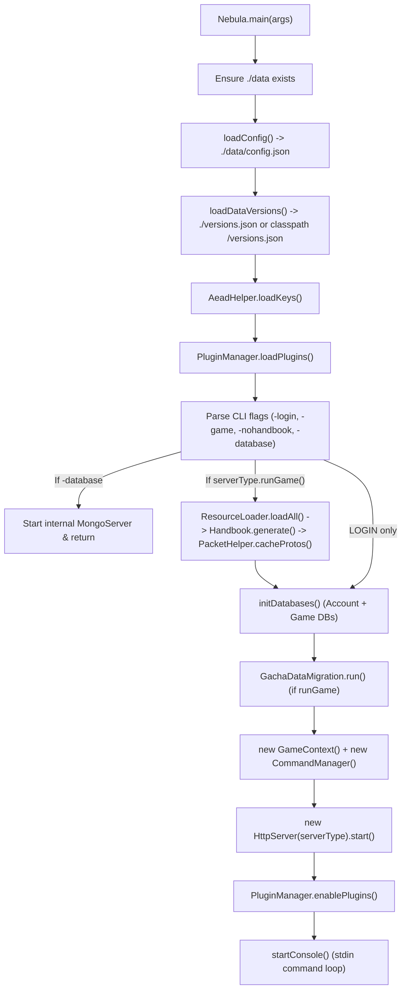

# Architecture Overview

Nebula is a single-process Java 21 server built on **Javalin** (Jetty), **Morphia** (MongoDB ODM), **Quickbuf** (zero-allocation protobufs), and **Reflections** (annotation-based auto-discovery).

## 1. Startup Sequence (`Nebula.main`)

Entrypoint: `src/main/java/emu/nebula/Nebula.java`.

### CLI Flags & `ServerType`

`Nebula.ServerType` uses bitflags to let a single jar act as login/dispatch, game server, or both:

| Flag | `ServerType` | Behavior |
| :--- | :--- | :--- |
| *(none)* | `BOTH` (`0x3`) | Loads resources, runs login + SDK + game endpoints, shares or splits DBs. |
| `-login` | `LOGIN` (`0x1`) | Skips `ResourceLoader`, `Handbook`, `PacketHelper.cacheProtos()`, and `/agent-zone-1/`. Only maps `@AccountDatabaseOnly` entities. |
| `-game` | `GAME` (`0x2`) | Runs game resources, game DB, and `/agent-zone-1/` without login/dispatch routes. |
| `-nohandbook` / `-skiphandbook` | *(modifier)* | Skips writing `./Nebula Handbook.txt` on startup (used in `Dockerfile`). |
| `-database` | *(standalone)* | Starts only the embedded MongoDB server and exits `main` after binding. |

## 2. HTTP & Game Routing (`HttpServer`)

`src/main/java/emu/nebula/server/HttpServer.java` starts a single Javalin server (HTTP or HTTPS via `keystore.p12` depending on `httpServer.useSSL`):

- **Login routes** (`serverType.runLogin()`):
  - Yostar SDK endpoints: `/common/config`, `/common/client-code`, `/common/version`, `/user/detail`, `/user/set`, `/user/set-info`, `/user/login`, `/user/quick-login`, `/user/send-sms`, `/yostar/get-auth`, `/yostar/send-code`
  - Static/patch metadata: `/meta/serverlist.html`
- **Game route** (`serverType.runGame()`):
  - `POST /agent-zone-1/` -> `AgentZoneHandler` (encrypted binary protobuf RPC endpoint)
- **Utility route** (always registered):
  - `POST /api/command` -> `RemoteHandler` (remote command execution when `remoteCommand.useRemoteServices` is enabled)

## 3. Global State vs. Player State

Nebula cleanly separates server-wide singletons from per-player state:

### Server-Wide (`GameContext`)
`src/main/java/emu/nebula/game/GameContext.java` owns:
- Active `GameSession` map (`token -> GameSession`)
- Global `GameContextModule` subclasses (`PlayerModule`, `GachaModule`, `TutorialModule`, `ActivityModule`, `ScoreBossModule`, `TraceHuntModule`, `JointDrillModule`, `BanModule`, `PayModule`)
- A 1-second `ScheduledExecutorService` (`GameContext.run()`) that:
  1. Checks daily/weekly/monthly reset rollover (`Utils.getResetEpochDay()`, `ResetCycle`), updating seasonal modules (`ScoreBossModule`, `TraceHuntModule`) and calling `player.checkResetDailies()` on online players.
  2. Expires inactive sessions via `cleanupInactiveSessions()` (`serverOptions.sessionTimeout`, default `300s`).

### Per-Player (`Player` & `PlayerManager`)
`src/main/java/emu/nebula/game/player/Player.java` owns all player-scoped managers (such as `CharacterStorage`, `Inventory`, `Mailbox`, `DormManager`, `QuestManager`, `ActivityManager`, etc.).

- **Rule of thumb**: Put cross-player or server-global state (active banners, leaderboards, bans, session registry, global activity schedules) in a `GameContextModule` on `GameContext`. Put player-owned progression and persistence in a `PlayerManager` (or dedicated Mongo entity) attached to `Player`.

## 4. Reflection-Based Auto-Discovery

Nebula avoids central registration boilerplate by scanning `emu.nebula` at startup with `org.reflections.Reflections`:

| Component | Annotation / Base Type | Discovered In |
| :--- | :--- | :--- |
| Packet handlers | `@HandlerId` + `extends NetHandler` | `AgentZoneHandler.registerHandlers()` |
| Resource definitions | `@ResourceType` + `extends BaseDef` | `ResourceLoader.loadResources()` |
| Database entities | `@Entity` (+ optional `@AccountDatabaseOnly`) | `DatabaseManager` constructor |
| Commands | `@Command` + `implements CommandHandler` | `CommandManager` constructor |
| Proto `nextPackage` setters | `extends ProtoMessage` | `PacketHelper.cacheProtos()` |
