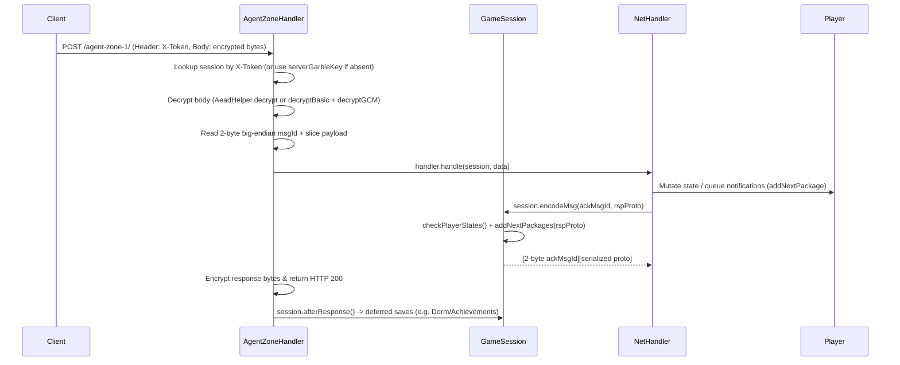

# Networking, Packet Handlers & Quickbuf

All in-game client/server traffic uses encrypted binary payloads sent over HTTP `POST /agent-zone-1/` and handled by `src/main/java/emu/nebula/server/routes/AgentZoneHandler.java`.

## 1. Request & Response Lifecycle



### Important Details in `AgentZoneHandler`
- **Two crypto phases**:
  - Before `ike_req` / `player_login_req` (no `X-Token` header), payloads use `AeadHelper.serverGarbleKey` (`decryptBasic` + `decryptGCM`).
  - Once `X-Token` is issued, payloads use the ECDH-negotiated `session.getKey()` (`encryptMethod`: AES-GCM or ChaCha20) with a 10-byte prefix offset (`offset = 10`).
- **Pre-handler guards**:
  - `NetHandler.requireSession()` defaults to `true`. Override to `false` for pre-session handshakes (e.g., `ike_req`).
  - `NetHandler.requirePlayer()` defaults to `true`. Override to `false` for `HandlerPlayerLoginReq` / registration handlers before a `Player` is bound to `GameSession`.
- **Null response = HTTP 500**: If `handler.handle(...)` returns `null` or throws an exception, `AgentZoneHandler` responds with HTTP `500` and empty body. Always return an encoded `*_failed_ack` when handling expected failure cases cleanly.

## 2. `NetMsgId` & Dummy Handlers

`src/main/java/emu/nebula/net/NetMsgId.java` defines all packet opcodes as `public static final int` fields:
- Requests end in `_req` (positive ints, e.g. `achievement_reward_receive_req`).
- Success responses end in `_succeed_ack`.
- Failure responses end in `_failed_ack`.
- Server push/piggyback notifications end in `_notify` (negative ints, e.g. `items_change_notify = -10001`).

At startup, `AgentZoneHandler.registerDummyHandlers()` iterates every `*_req` field in `NetMsgId` that does **not** have a registered `@HandlerId` class and automatically binds a fallback handler that returns `PacketHelper.encodeMsg(failedAckId)` (the matching `*_failed_ack` with empty payload).

## 3. Writing a New Packet Handler

1. Locate the request/ack IDs in `src/main/java/emu/nebula/net/NetMsgId.java` and the generated Quickbuf classes in `src/generated/main/emu/nebula/proto/`.
2. Create a class in `src/main/java/emu/nebula/server/handlers/` named `Handler<PacketName>` extending `NetHandler`.
3. Annotate it with `@HandlerId(NetMsgId.<request_opcode>)`.
4. Implement `handle(GameSession session, byte[] message)`:

Example from `src/main/java/emu/nebula/server/handlers/HandlerAchievementRewardReceiveReq.java`:

```java
package emu.nebula.server.handlers;

import emu.nebula.net.NetHandler;
import emu.nebula.net.NetMsgId;
import emu.nebula.proto.AchievementRewardReceive.AchievementRewardReq;
import emu.nebula.net.HandlerId;
import emu.nebula.net.GameSession;

@HandlerId(NetMsgId.achievement_reward_receive_req)
public class HandlerAchievementRewardReceiveReq extends NetHandler {

    @Override
    public byte[] handle(GameSession session, byte[] message) throws Exception {
        // 1. Parse Quickbuf request
        var req = AchievementRewardReq.parseFrom(message);

        // 2. Delegate business logic to player manager
        var change = session.getPlayer().getAchievementManager().recvRewards(req.getIds());

        // 3. Return failed ack on invalid state
        if (change == null) {
            return session.encodeMsg(NetMsgId.achievement_reward_receive_failed_ack);
        }

        // 4. Encode succeed ack
        return session.encodeMsg(NetMsgId.achievement_reward_receive_succeed_ack, change.toProto());
    }
}
```

### Returning Structured Error Codes

When the client expects an `Error` payload on `*_failed_ack`, pass `Error.newInstance().setCode(...)` from `emu.nebula.proto.Public.Error` and `PlayerErrorCode` (`src/main/java/emu/nebula/game/player/PlayerErrorCode.java`):

```java
return session.encodeMsg(
    NetMsgId.player_login_failed_ack,
    Error.newInstance().setCode(PlayerErrorCode.ErrLogin.getValue())
);
```

## 4. Working with Quickbuf Protos

Nebula uses `us.hebi.quickbuf` instead of standard Google protobuf-java:
- **Instantiate**: Always use `MyMessage.newInstance()` (never `new MyMessage()`).
- **Parse**: `MyMessage.parseFrom(byteArray)`.
- **Builder-style chaining**: Setters return `this`, e.g., `proto.setId(1).setLevel(10)`.
- **Nested submessages**: Use `proto.getMutableSubField().setX(...)` to populate an embedded message in-place without allocating a separate instance.
- **Repeated fields**: Use `proto.addItems(item)`, `proto.addAllIds(arr)`, or `proto.getMutableItems().add(...)`.
- **Empty check**: `proto.isEmpty()` checks whether any fields are set.

## 5. `PlayerChangeInfo` & `nextPackage` Chaining

Because the game communicates over request/response HTTP (`POST /agent-zone-1/`), the server cannot open unsolicited push sockets. Instead, extra notifications are **piggybacked** inside the response proto's `nextPackage` bytes field:

1. **Queuing notifications**: Call `player.addNextPackage(NetMsgId.some_notify, notifyProto)` anywhere during request processing.
2. **Automatic chaining**: When `session.encodeMsg(...)` runs:
   - `GameSession.checkPlayerStates()` checks mailbox/handbook red-dot notifications.
   - `GameSession.addNextPackages(proto)` pops queued `NetMsgPacket`s from `player.getNextPackages()` and chains them via `PacketHelper.setNextPackage(...)` (using cached `ReflectASM` indices built at startup by `PacketHelper.cacheProtos()`).
   - If you call `session.encodeMsg(msgId)` with **no** proto and `nextPackages` is non-empty, `GameSession` wraps the chain inside `Public.Nil`.
3. **Item/Resource deltas (`PlayerChangeInfo`)**:
   - Inventory mutations (adding/consuming items, chars, discs, resources, skins) return a `PlayerChangeInfo` (`src/main/java/emu/nebula/game/player/PlayerChangeInfo.java`).
   - `PlayerChangeInfo.add(proto)` wraps each delta inside `type.googleapis.com/proto.<SimpleName>` (`Any`) and serializes to `Public.ChangeInfo` via `change.toProto()`.
   - When a packet does not return `ChangeInfo` directly in its ack, queue `player.addNextPackage(NetMsgId.items_change_notify, change.toProto())`.
